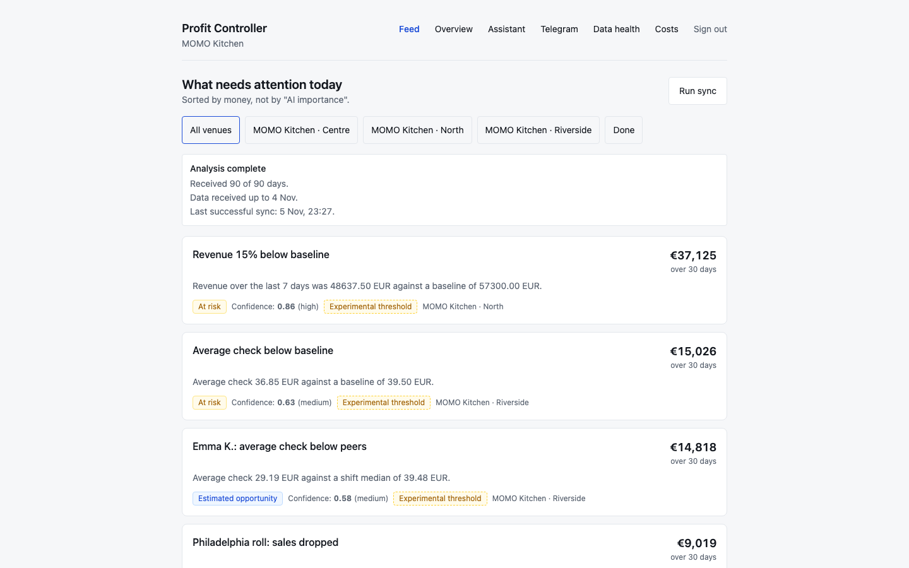
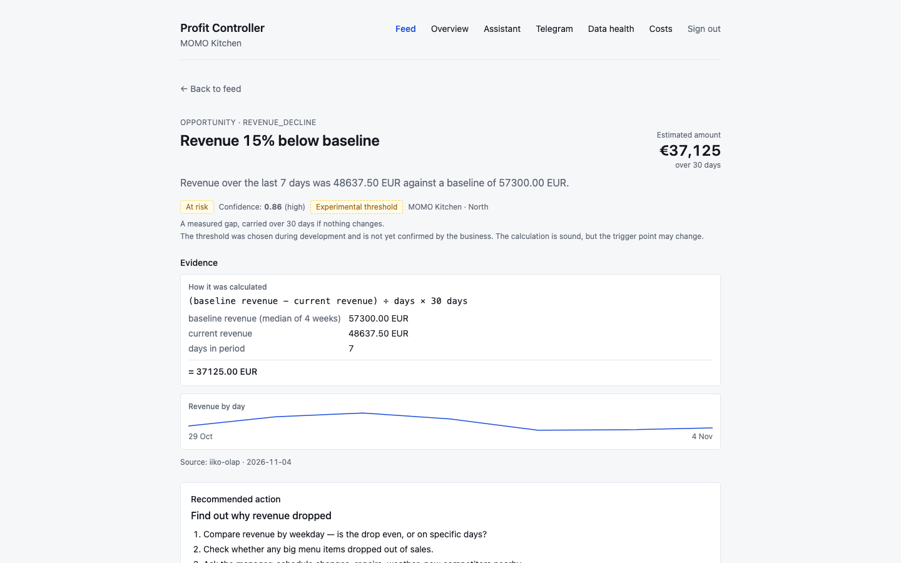
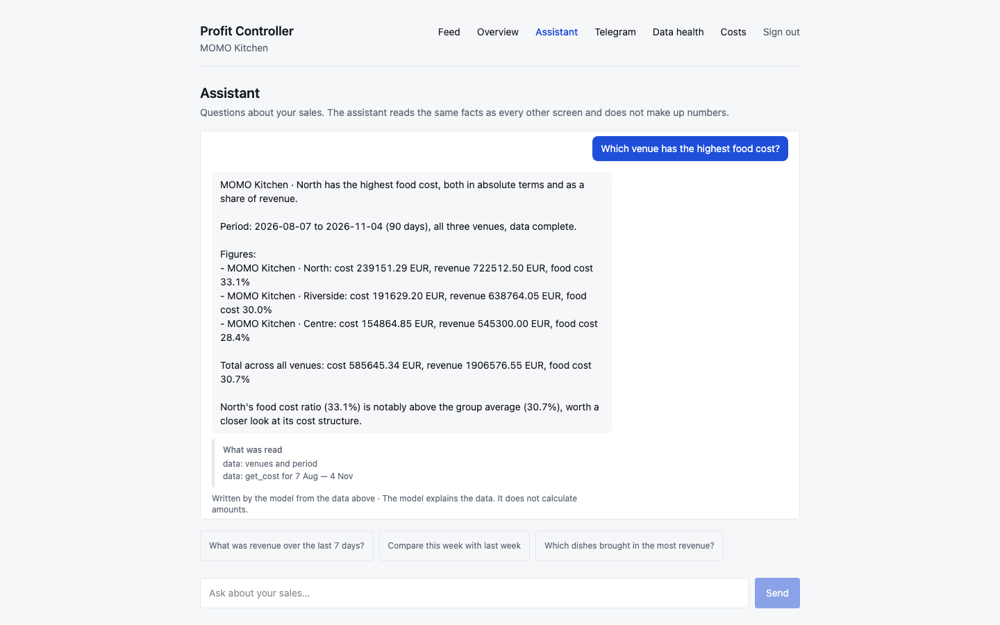
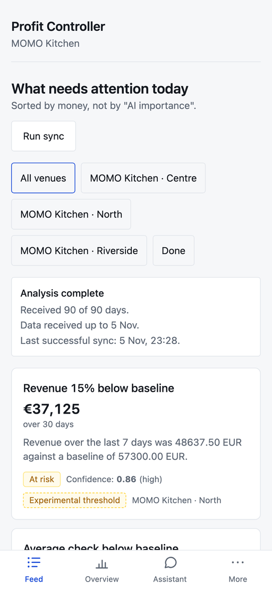

# Profit Controller

Restaurant analytics on iiko POS data. A single screen answers one question: what needs attention today. The answer is a list of findings ranked by how much money they cost.

```
data → deterministic metrics → finding → money impact → evidence + confidence
     → recommended action → recorded outcome → recovered value
```



Screenshots show demo mode: three venues of a made-up restaurant group with sample data. The assistant's answer comes from the live model.

## Screens

A finding shows the formula, the inputs and the data source next to the amount:



The assistant answers from the same facts as the other screens and lists what it read:



The feed on a phone:

<p align="center">
  
</p>

## What it does

- Pulls sales and cost data from iikoServer through a connector.
- Computes metrics deterministically. Each finding is quantified in money, and the evidence and a "how calculated" line come with it.
- When the owner asks why, an assistant on the Claude API explains the metrics the engine already computed.
- The owner records what was done and how much money it recovered.
- Demo mode replays anonymized fixtures through the same code path as the live connector, so it runs without credentials.

## Testing

- 600+ Vitest unit and integration tests, plus Playwright end-to-end tests for the main user journey.
- One `check` command runs format, lint, typecheck, architecture rules, unit tests, connector contract tests, golden tests, integration tests and the build. All of it runs in GitHub Actions.
- No test calls a live model. Model smoke tests exist, but they are opt-in.

## Stack

| Area | Tech |
|---|---|
| App | Next.js (App Router), TypeScript |
| Data | PostgreSQL, Drizzle ORM |
| Auth | better-auth |
| AI | Anthropic Claude API |
| Delivery | Docker, Caddy, GitHub Actions |

The source is private. I'm happy to walk through the code on a call: chumak.aleksandr96@gmail.com
